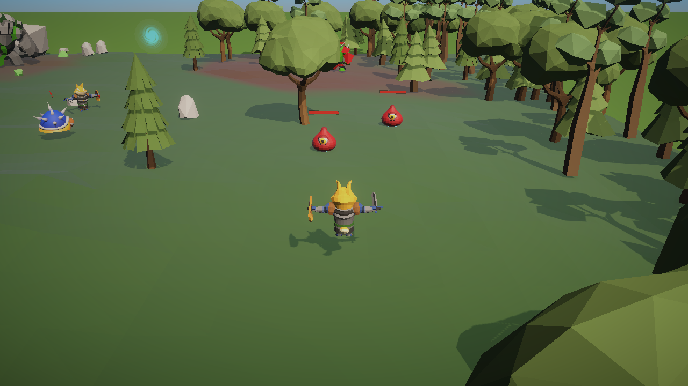

# 3DRPG

一个用 **Unity 2022.3 + URP** 做的 3D 点击式动作 RPG 学习项目。

点击移动、近战攻击、暴击、敌人状态机、Boss 战与投石反弹、传送门跨场景、等级成长、存档读档、主菜单。



<p>
  
  
  
</p>

---

## 目录

- [怎么玩](#怎么玩)
- [功能](#功能)
- [操作](#操作)
- [项目结构](#项目结构)
- [核心设计](#核心设计)
- [数值表](#数值表)
- [存档说明](#存档说明)
- [已知问题](#已知问题)
- [环境](#环境)
- [第三方资源](#第三方资源)

---

## 怎么玩

### 直接下载可执行版本

到 [Releases](https://github.com/niminimin/3DRPG/releases) 下载 `3DRPG-v1.0.0-win64.zip`：

```
解压 → 双击 3DRPG.exe
```

> 需要连同同目录的 `3DRPG_Data`、`UnityPlayer.dll`、`MonoBleedingEdge` 一起保留，不能只拷 exe。

### 用 Unity 打开工程

1. `git clone` 本仓库
2. Unity Hub → Add → 选择工程目录，用 **2022.3.62f3c1** 打开
3. 首次打开会重建 `Library/`（几分钟，属正常现象）
4. 打开 `Assets/Scenes/MainMenu.unity`，按 Play

---

## 功能

| 系统 | 内容 |
|---|---|
| **主菜单** | 新游戏 / 继续（无存档灰掉）/ 退出；已有存档时开新游戏会二次确认 |
| **移动与战斗** | 点击移动、点敌人自动走近攻击、暴击（2 倍伤害）；命中判定由**动画事件**驱动 |
| **受击表现** | 受击动画、击退、击飞 + 眩晕（兽人技能）、暴击硬直 |
| **敌人 AI** | 守卫 / 巡逻 / 追击 / 攻击 / 返回 / 庆祝 / 死亡 状态机 |
| **Boss 机制** | 岩石巨像远程投石，石头落地后可点击打回，反弹造成 25 点伤害 |
| **场景切换** | 营地 ↔ 绿洲，传送门按 id 配对，落点由目标门实时计算 |
| **成长** | 击杀获得经验，10 级成长曲线，升级加 HP / 攻击 / 防御 |
| **存档** | 玩家位置、等级、经验、血量 + 敌人死亡状态；死亡自动回到最近存档 |
| **UI** | 血条（延迟条）、Boss 血条、经验条、伤害飘字（对象池）、暂停菜单 |
| **表现** | 角色被遮挡时的描边（Occlusion Shader + Render Objects）、黑幕淡入淡出、Cinemachine 跟随相机 |

---

## 操作

| 输入 | 行为 |
|---|---|
| **鼠标左键 点地面** | 走向该位置（只响应 `Ground` 标签的碰撞体） |
| **鼠标左键 点敌人** | 走近并攻击 |
| **鼠标左键 点石头** | 走近并把石头打回 Boss（巨像战中） |
| **鼠标左键 点传送门** | 走到门口并传送 |
| **ESC** | 暂停菜单（继续 / 保存 / 读取 / 新游戏 / 回主菜单 / 退出） |

---

## 项目结构

```
Assets/
├─ Scenes/
│  ├─ MainMenu.unity     启动场景：主菜单 + 3D 背景
│  ├─ Boot.unity         常驻场景：玩家、相机、UI、管理器
│  ├─ SampleScene.unity  内容场景：营地（地形、6 个敌人、传送门）
│  └─ GreenWorld.unity   内容场景：绿洲
├─ Scripts/
│  ├─ Character/         玩家、敌人、战斗组件
│  │  ├─ Player/         PlayerController、PlayerProgress
│  │  └─ Enemy/          EnemyController、EnemyCombat、各 Boss 子类
│  ├─ CharacterStates/   CharacterStats、ScriptableObject 数据定义
│  ├─ EnemyStates/       敌人状态机（每个敌人的专属状态）
│  ├─ SaveLoad/          SaveData、SaveManager、SaveIdentity
│  ├─ UI/                HUD、血条、飘字、暂停菜单、主菜单
│  ├─ World/             WorldLoader、Portal、PortalRegistry、CameraRig、SceneFader
│  └─ Managers/          MouseManager、GameManager、Singleton
├─ GameData/             ScriptableObject 数值资产
├─ Prefabs/              玩家、敌人、传送门、石头、UI
├─ Art Assets/           商店素材（角色、树木、地面）
├─ Material/             URP 材质 + Occlusion Shader（遮挡描边）
├─ Settings/             URP 资产与 Renderer 配置
└─ Editor/               编辑器工具（存档 ID 分配等）
```

---

## 核心设计

### 场景架构：常驻 Boot + 叠加内容场景

```
MainMenu ──(新游戏/继续)──► Boot（常驻，不卸载）
                              │
                              └─ Additive 加载 ─► SampleScene / GreenWorld
```

- **Boot** 持有玩家、相机、UI、管理器 → 切场景只换地形，不用重建任何系统
- **WorldLoader** 负责四条路径：开局 / 传送门 / 读档 / 新游戏
- 内容场景加载后会设为**激活场景**，天空盒、环境光、雾按该场景的配置走

### 数据驱动

数值都在 ScriptableObject 里，改数值不用改代码：

| 资产 | 内容 |
|---|---|
| `CharacterDataSO` | 生命、防御、经验奖励 |
| `AttackDataSO` | 攻击距离、技能距离、冷却、伤害区间、暴击 |
| `PlayerLevelDataSO` | 等级上限、经验曲线、每级成长 |

运行时状态（当前血量、等级加成）都在组件里，**不会写回 SO**。

### 伤害流程

```
攻击动画播到命中帧
   → 动画事件 OnAttackHit / OnSkillHit / OnMeleeHit
   → 距离校验
   → CharacterStats.TakeDamage(DamageResult { amount, isCritical })
   → OnHealthChanged（血条）+ OnDamaged（飘字、受击）+ OnDead（状态机 / 经验 / 存档）
```

伤害由动画事件驱动，改动画速度也不会错位。

### 敌人状态机

```
GUARD ──看到玩家──► CHASE ──进入攻击距离──► ATTACK
  ▲                   │                      │
  └──── RETURN ◄──────┴──────────────────────┘
     任意状态 ──血量归零──► DEAD
```

每个敌人用**工厂方法**决定自己的守卫/攻击状态（例如兽人用带二段击飞技能的 `GruntAttackState`）。

### 传送门

```csharp
Portal { id, targetScene, targetDoorId, standDistance }
```

- 落点不用坐标，而是**目标门的 Transform 现算**：`door.position - door.forward * standDistance`
- 门在 `Awake` 时自己注册进 `PortalRegistry`（字典），加载场景后 O(1) 查表，不遍历场景树

### 存档

两层语义：

| 层 | 时机 |
|---|---|
| **内存层** | 敌人一死立刻记录 → 换场景回来它还死着 |
| **磁盘层** | 只有点「保存」才写入 JSON |

只存必需的东西：玩家位置/等级/经验/血量 + 敌人死亡 id 列表。

---

## 数值表

| 单位 | 生命 | 防御 | 伤害 | 经验 |
|---|---|---|---|---|
| 玩家 | 100（+15/级） | 2（+1/级） | 4~6（+3/级），暴击 2 倍 / 20% | — |
| 史莱姆 | 30 | 2 | 2~4 | 25 |
| 龟壳兵 | 45 | 4 | 6~10 | 40 |
| 兽人队长 | 60 | 6 | 6~10 | 120 |
| 岩石巨像（Boss） | 200 | 10 | 10~16 | 400 |

| 成长 | 值 |
|---|---|
| 等级上限 | 10 |
| 升级所需经验 | 40 / 70 / 110 / 160 / 220 / 300 / 400 / 520 / 660 |
| 每级成长 | +15 生命 / +3 攻击 / +1 防御 |

| Boss 机制 | 值 |
|---|---|
| 石头反弹伤害 | 25 |
| 兽人技能冷却 | 8 秒（二段击飞 + 眩晕） |

---

## 存档说明

```
%USERPROFILE%\AppData\LocalLow\DefaultCompany\3DRPG\save_0.json
```

- 玩家死亡后会自动读取最近存档；没有存档则重新开始
- 编辑器里还有菜单工具：`Tools → 存档`（分配 ID / 检查重复 / 打开存档目录 / 删除存档）

---

## 已知问题

- **敌人待机/走路动画不播放**：四个敌人动画控制器的 `Base Layer` 权重是 0，只有攻击 / 受击 / 死亡 / 追击动画生效（待机时是模型绑定姿势）。把 `Base Layer` 权重改为 1 即可修复。
- 只有单存档槽位，没有多存档。
- 打回石头只对岩石巨像有意义（其他敌人没有投石）。

---

## 环境

| 项 | 版本 |
|---|---|
| Unity | 2022.3.62f3c1 |
| 渲染管线 | URP 14.0.12（`Assets/Settings/URP-HighFidelity`） |
| 输入 | 旧版 Input Manager（`Input.GetMouseButtonDown`） |
| 相机 | Cinemachine（FreeLook） |

工程内嵌了两个包（不走 Package Manager 在线解析）：

- `Packages/com.unity.progrids` (3.0.3-preview.6) —— 网格吸附
- `Packages/com.unity.settings-manager` (1.0.3) —— ProGrids 的依赖

仓库已配置 `UnityYAMLMerge` 作为 `.unity` / `.prefab` / `.asset` 的合并驱动；换行策略为 YAML 用 LF、C# 用 CRLF。

---

## 第三方资源

美术资源来自以下商店素材包（版权归原作者，仅用于学习演示）：

- **SimpleNaturePack** —— 树、石头
- **RPG Monster DUO PBR Polyart** —— 场景道具、天空盒
- **DogKnight** —— 玩家模型与动画
- **Mini Legion Grunt / Rock Golem** —— 兽人、岩石巨像
- **URP / Cinemachine** —— Unity 官方包

> ⚠️ 这些素材**不适用本项目的代码许可**。如需商用请自行购买授权，并且不要再分发原始资源文件。

## License

代码部分供学习参考，未指定开源许可证。第三方美术资源版权归各自作者所有。
